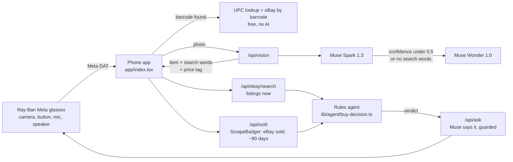

# Reskale Glasses

**Reskale tells you whether to buy it.**

A reseller in a thrift store or at the bins has both hands full and a few seconds per item. Reskale Glasses runs on Ray-Ban Meta glasses. Look at an item and press the glasses button or say "Reskale, scan". Muse identifies it, eBay says what it really sells for, and an agent tells you in your ear: **buy it** or **pass**, with the reason.

Built for the Meta Global AI Developer Hackathon (Indie Developer track, "Build for Your World"). [HACKATHON.md](HACKATHON.md) says what was built when. [SUBMISSION.md](SUBMISSION.md) has the entry text.

## How it works



1. **Photo.** The glasses take a photo and turn it upright. If the scan box is on, it is cropped to the box.
2. **Barcode first.** If the photo has a product barcode, the free UPC database and eBay's barcode search name the item, and Muse is not called.
3. **Muse identifies it.** Spark returns JSON matching a schema: brand, model, category, condition, a short eBay search, its confidence (0–1), and the price on any visible price tag. If Spark's confidence is under 0.5, or it has no search words, the same photo goes to Wonder.
4. **The market.**
   - eBay Browse gives the listings for sale now.
   - ScrapeBadger gives eBay's sold listings, about 90 days of them. The typical sold price is their median, with Best Offer sales left out (their listed price is the ask, not the sale) and at least 3 sales needed.
   - Sell-through is sold ÷ listed now.
5. **The agent decides.** It's a pure function in code (below), so the same two numbers always give the same answer.
6. **Muse says it.** The verdict and its numbers go to Muse, which says them in one or two short sentences. The server keeps Muse's sentence only if it opens with the same verdict ("Buy" or "Pass"), doesn't name the other one, and is short. Otherwise the rules' own sentence is spoken.

### The rules (`lib/agent/buy-decision.ts`)

| Rule | Constant | Test |
|---|---|---|
| Money | `RETURN_MULTIPLE = 3` | typical sold price × (1 − 16.5% eBay fees) **≥ 3 ×** the store's price. The fees are the 13.5% final value fee plus a 3% promoted listing. The comparison is in whole cents. |
| Speed | `MIN_SELL_THROUGH = 0.3` | sold in 90 days ÷ listed now **> 30%** |

| Verdict | When | Badge |
|---|---|---|
| **BUY** | Both rules pass | BUY |
| **PASS** | Either rule fails. It names the rule that failed and the most to pay to still make 3×. | PASS |
| **NEED PRICE** | The market is good but the price isn't known. It asks: "What's the price?" If Muse read a price tag: "I see a 4 dollar tag. Say Reskale, yes to use it." | PRICE? |
| **NOT ENOUGH DATA** | Sold data or the listed count is missing. It never guesses: an unknown count is unknown, not 0. | NO CALL |

### Where Muse is used, and where it isn't

| Muse does | Muse never does |
|---|---|
| Identifies the item and writes the eBay search (Spark, then Wonder if unsure) | Decides buy or pass |
| Reads the store's price tag in the photo | Changes a verdict or its numbers (the guard throws such a sentence away) |
| Answers spoken questions ("Reskale, who makes this?") from the facts of the last scan only | Guesses a number it wasn't given (its instructions say to answer that it doesn't know) |
| Says the verdict in its own words | Sees anything but the photo and those facts |

### The $150 cap (`lib/muse/budget.ts`)

- Each Muse call first reserves its worst case: 2,000 input tokens plus 3,000 per image, and 4,000 output tokens, at that model's price.
- A call that would take spent + reserved past `MUSE_BUDGET_USD` (default **150**) is refused before anything is sent. The seller hears "The Muse budget for this demo is used up."
- Afterwards, the reservation is settled to the real `usage × price`.
- The running total is kept in `.muse-usage.json` (git-ignored), so the cap holds across restarts. A warning is logged at 80%.
- Each call logs its model, time, tokens, cost and the running total.

| Model | Input / 1M tokens | Output / 1M tokens | Used for |
|---|---|---|---|
| `muse-spark-1.3` | $1.25 | $4.25 | identify, questions, verdict wording |
| `muse-wonder-1.0` | $4.00 | $20.00 | identify again when Spark is unsure |

## Talking to it

Every command starts with "Reskale". Without it, anything heard in a loud store is ignored, so no one nearby can spend a paid lookup.

| Say | Does |
|---|---|
| "Reskale, scan" / "next" | Photograph and identify (the same as a button press) |
| "Reskale, it's 5 dollars" / "the tag says 4.99" / "they want 20" / "paid 3" | The store's price. The verdict follows. |
| "Reskale, yes" / "no" | Use (or don't use) the price tag Muse read |
| "Reskale, should I buy it?" / "buy or pass?" / "is it worth buying?" / "what's the verdict?" | The agent's verdict again |
| "Reskale, what does it sell for?" (also "new" / "used"), "how many sold?", "how many are listed?", "what's the sell-through?", "what is it?" | Answered by Muse from the last scan, with Reskale's own words as the fallback |
| Any other question: "Reskale, who makes this?" | Muse, from the last scan only |
| "Reskale, change search to …" / "search for …" | Search different words |
| "Reskale, condition used" / "new" / "all" | Filter the listings |
| "Reskale, search in video games category only" / "search every category" | One eBay category, or all of them |
| "Reskale, minimum list price based on 5 dollars" | List price that makes 3× (used) or 2× (new) after fees |
| "Reskale, cost to purchase at 3 pounds" | Bins price at $1.67/lb, then the list price |
| "Reskale, cost to ship 2 pounds" / "… 12 by 10 by 6" | Rough USPS Ground Advantage and Priority Mail prices |
| "Reskale, multi-shot" / "single" / "search them" | Several photos of one item |
| "Reskale, stop" / "repeat" / "cancel" | Stop talking, say it again, abandon the scan |

Glasses button: **press** to scan, **double** to stop (or to search the multi-shot set), **hold** to repeat, **triple** to switch single and multi-shot.

## Setup

You need an Android phone with the Meta AI app, paired Ray-Ban Meta glasses, and Node 20+.

1. `npm ci`. Its postinstall applies the two patches in `patches/`; one stops the Expo dev server's manifest from timing out.
2. Copy `.env.example` to `.env` and fill it in:
   - `MODEL_API_KEY`: the Meta Model API key;
   - `MUSE_BUDGET_USD`: defaults to 150;
   - `EBAY_APP_ID` and `EBAY_CERT_ID`: an eBay production keyset;
   - `SCRAPEBADGER_API_KEY`;
   - `EXPO_PUBLIC_API_URL`: optional; Metro serves the API routes by default.
3. **The app build.** This repo runs on the "Reskale Glasses" Android development build, `com.reskale.app.glasses`. `app.config.js` carries that identity, so `npx expo run:android` builds it. No native rebuild was done during the hackathon: the installed build came from the Reskale app (see HACKATHON.md).
4. **Meta AI Developer Mode.** In the Meta AI app go to Settings → App info and tap the version number 5 times. It resets when the Meta account changes.
5. **Run:**
   ```
   adb reverse tcp:8081 tcp:8081
   APP_VARIANT=glasses npx expo start --dev-client --port 8081
   ```
   Open Reskale Glasses, tap 🕶️ **Connect**, then **Connect to Meta AI**. **Wear the glasses**: Meta's toolkit only works while they are on someone's face. In a debug build, the Developer row "Use test glasses (phone camera)" runs Meta's Mock Device Kit with the phone's back camera instead.

## Limits

- **Experimental Meta features.** The glasses capture button (Inputs) and "Hey Meta, start Reskale" are experimental Meta features, and Meta does not publish apps that use them. A store version would scan from the on-screen button and the "Reskale, …" voice commands.
- **The app must stay open.** Meta's toolkit has no background camera, so the screen stays on while scanning.
- **Speech restarts.** Meta's speech recognition stops about 60 s after it starts and doesn't say so, so the app restarts it every 55 s (`SPEECH_CYCLE_MS`).
- **Android only here.** The barcode reader in this repo is Android's.
- **One machine.** The Muse ledger is a local file kept by the dev server. It is not shared between servers.
- **eBay's window.** The sold window is eBay's own, about 90 days.

## Tests

`npm test` (Vitest) runs 17 files and 303 tests, last run Nov 4. They cover the agent's rules and edges (exactly 3×, exactly 30%, missing data), the spoken verdict, Muse's budget, the identify parsing and escalation, the verdict guard, ScrapeBadger parsing (Best Offer left out), the voice phrases, the spoken calculator, and the glasses helpers. `npx tsc --noEmit` reports no errors.

---

© 2026 Reskale. All rights reserved. No licence is granted to use, copy, modify or distribute this code.
